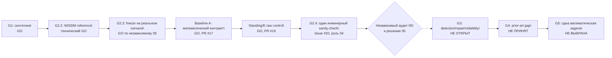

# Дорожная карта проекта — актуальная координационная версия

**Срез:** 2026-11-04 · **Единый источник решения:** `docs/DECISIONS.md`, `docs/PROJECT_STATE.md`, `docs/NEXT_ACTION.md`. Рисунки `docs/roadmap.png` и `docs/roadmap.svg` **исторические** и могут не отражать новый статус; эта текстовая таблица актуальнее. Никаких придуманных календарных дедлайнов.

## Этапы и пороги доказательности

| Этап | Реальная готовность | Следствие |
|---|---|---|
| G0 | Организационные границы и разделение старых направлений A/B с C зафиксированы | Не означает утверждённую тему ВКР |
| **G1** | **GO:** игрушечный синтетический freeze-сигнал, runnable Python, тесты, аудит | Проверка механики, не физических сенсорных отказов |
| **G2.1 / G2.2** | **Технический GO:** независимый precheck WISDM и read-only 1600/A, принятый PR #8, график | q unit/полные official UCI bytes/session identity остаются UNKNOWN |
| **G2.3** | **Технический GO (LAB-025):** α=0/1, x freeze [1191,2382), точная Z и метрики; PR #13 + audit PR #15 приняты в main | Принят только искусственный freeze одной записи; не качество detector/repair/ML |
| **Full G2** | **NOT GO:** полный provenance и независимый dataset/split protocol пока не закрыты | Нельзя научно оценивать generalization по одной записи |
| **G2.4 baseline A** | Контракт 03 и вход Standing/E приняты по LAB-026/027; **разрешён только код G2.4, результаты ещё не получены** | L=3 фиксирован, existing baseline, не собственный метод; до 05 аудитa и 00 нельзя считать реализацию принятой |\n| **G3** | NOT OPEN: три задачи детекция, восстановление, selective reliability | Сначала формализовать контракт baseline/split и получить разрешение 00 |
| **G4** | LIMITED SCOUT: проверены аналоги 2025–2026, но полной prior-art matrix нет | Научная ниша и вклад не подтверждены |
| **G5/G6** | NOT OPEN | Никаких собственных методов, научных улучшений/публикационных claims заранее |

## Три результата — три разных критерия готовности

| Цель | Следующая доказательная опора | Когда можно считать готовым |
|---|---|---|
| **1. Хабр** | Реальный runnable demo + честный baseline и failure cases | Только после воспроизводимого сравнительного стенда и независимого 05 аудита; публиковать инженерные, не научные claims |
| **2. Научная статья** | **Отдельный** результат старых A/B EEG/HFD, audit + closest prior art + подходящее издание | После самостоятельного решения 00, *не* из этих WISDM графиков |
| **3. НИР-7** | Методология, 10+ библиографических источников, математическая постановка, реальные G1/G2 эксперименты и ограничения | По официальному документу МИСИС 2025–2026, применимость его правил к 2026–2027 отдельно UNKNOWN; подготовка будущей ВКР, но тема не утверждена |

Полная карта и требования НИР: `docs/publications/THREE_OUTPUTS_AND_NIR7_PLAN.md`. Литературная разведка: `docs/research/G4_SCOUT_FREEZE_2026-11-04.md`.

## Ровно один текущий тикет

**[Issue #20 — роль 04 реализует ограниченный G2.4 baseline A](https://github.com/kr13t1/ts-reliability-lab/issues/20)**. Standing/E input принят в PR #19 (LAB-027); без подбора параметров, только фиксированные три случая и separate evaluator. PR с кодом должен пройти независимый аудит 05 перед решением 00 о merge. Full G2 NOT GO и G3 закрыт.
