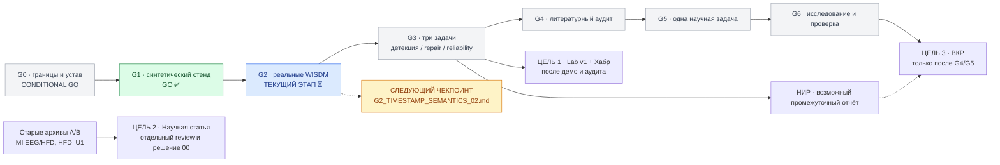

# Дорожная карта проекта

**Актуально на 2026-11-03.** Статусы указаны согласно последнему решению LAB-017 от 2026-11-01. G2 ещё НЕ GO. Рисунок: [PNG](docs/roadmap.png) · [SVG](docs/roadmap.svg).

## Контрольные точки и критерии

| Чекпоинт | Что необходимо проверить | Текущий статус |
|---|---|---|
| G0 | Устав, отдельное хранение прежних A/B материалов, журнал решений | CONDITIONAL GO |
| G1 | Синтетический эксперимент, воспроизведение, тесты, аудит, объяснение результата | **GO (LAB-010)** |
| **G2.1 — сейчас** | Источники и смысл timestamp, неоднородность частот и границы блоков; отчёт 02 с CONFIRMED / ASSUMED / UNKNOWN | **NEXT** |
| G2.2 | Полный подтверждённый протокол подготовки реальных записей, raw provenance, независимые группы и аудит | WAIT |
| G3 | Для каждого из трёх направлений отдельный простой baseline и метрика на фиксированных сценариях | WAIT |
| G4 | Обзор близких работ 2023–2026; проверка потенциальной ниши и сильных baseline | Предварительная разведка, полный G4 WAIT |
| G5 | Выбор **одной** научной задачи, гипотез, метрик и критериев | WAIT |
| G6 | Воспроизводимое сравнение, независимый аудит, отрицательные случаи, публикационные материалы | WAIT |

## Три целевых выхода

- **Выход 1: Lab / Хабр.** Научные claims ограничены. Первую полноценную техническую публикацию готовить после G3 и подтверждённой демонстрации; репозиторий — самостоятельный инженерный продукт.
- **Выход 2: статья по A/B.** Не отождествлять с WISDM и не подменять HFD-classification на HFD–U1. Ветке 00 требуется отдельное решение после независимого литературного и результатного аудита.
- **Выход 3: НИР / ВКР по C.** НИР можно строить на честно описанной лаборатории. Тему/вклад ВКР выбрать только после G4–G5, до этого название предварительное.

**Оценки активной работы (НЕ дедлайны):** G2 timestamp 2–5 ч; G2 полный протокол 5–10 ч; первый график реальной записи после утверждения G2 5–10 ч; сравнение baseline 10–20 ч; Lab v1 20–40 ч. Научная статья и тема ВКР не имеют гарантированного срока или положительного результата.
