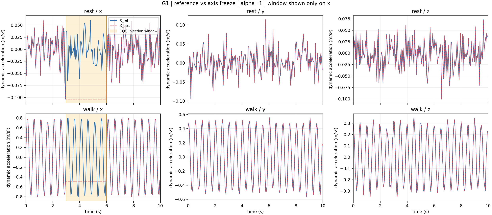
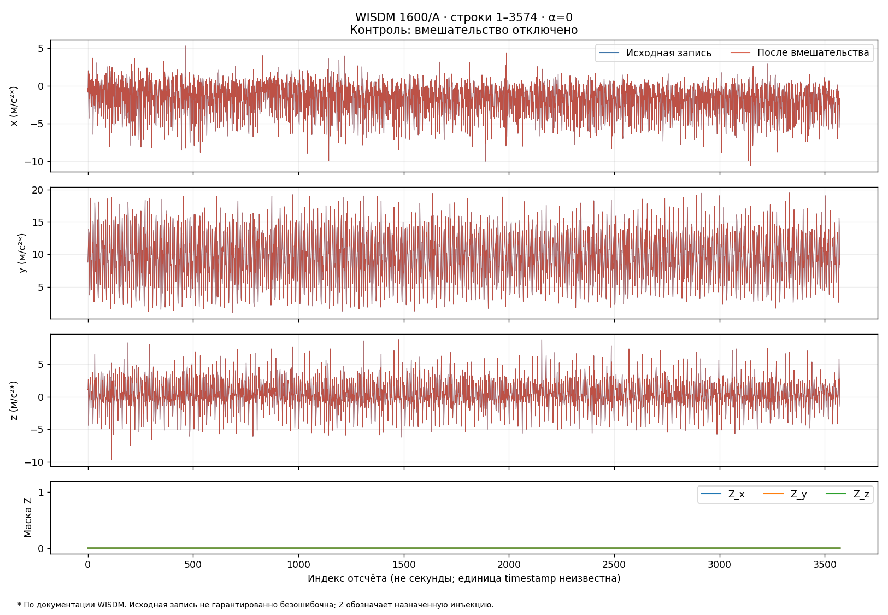
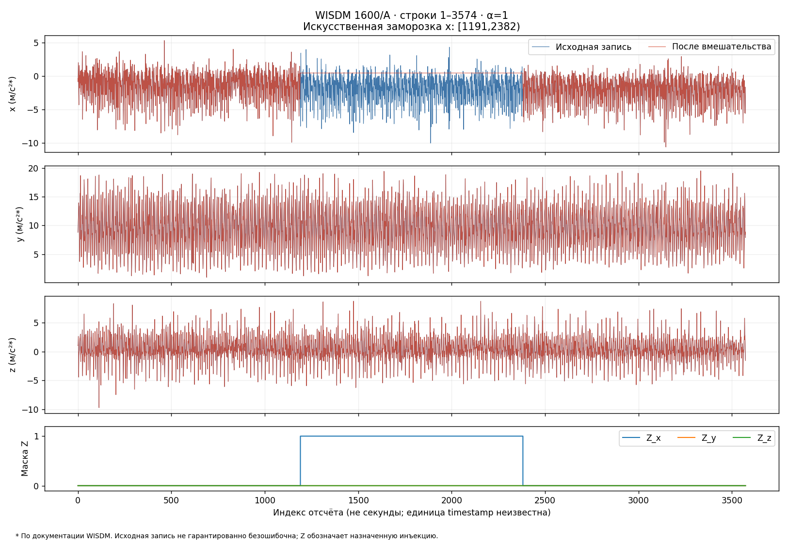

# Лаборатория: посмотреть результаты за пять шагов

**Дата:** 2026-11-04 · **Тип:** инженерная **наглядная демонстрация** на зафиксированных исходниках; **не** эксперимент для научной статьи.  
**Согласованные решения:** LAB-025 (G2.3 freeze), LAB-026 (математический baseline A), LAB-027 (вход Standing/E), LAB-029 (технический G2.4 GO после 05). **Истина о статусе:** [PROJECT_STATE.md](PROJECT_STATE.md).  
**Источник:** WISDM UCI 507 (Gary M. Weiss, 2019), [DOI 10.24432/C5HK59](https://doi.org/10.24432/C5HK59), CC BY 4.0; все искусственные изменения и авторская демонстрация должны быть явно атрибутированы.

## Что уже можно увидеть в репозитории без программирования

### 1. Синтетическая G1, чтобы понять идею



[Искусственная карта назначенного повреждения G1](../g1/results/mask.png). Это **не** классификация настоящих неисправностей и не новое научное доказательство.

### 2. Настоящая WISDM Walking/A запись, контроль без искусственной инъекции



### 3. Та же запись, искусственно замороженная ось X



В G2.3 **известное** воздействие: subject=1600, activity=A=Walking, исходные строки 1..3574, ось X и индексы **[1191,2382)**, `alpha=1` удерживает значение `x[1190]`. **1191** точке назначена инъекция. Y, Z и q не изменяются. **RMSE=3.0753845270371265 — мера внесённого изменения, а не результат поиска или восстановления.**

## 4. Самостоятельно запустить первый детектор G2.4 на реальных байтах

### Необходимый локальный вход

В GitHub **нет** полного сырого WISDM TXT. Нужен `data_1600_accel_phone.txt`, полученный из проверенного Project-транспорта `G2_RAW_FOR_AUDIT_05.zip`, **без редактирования содержимого**. Разместить его в `data/raw/data_1600_accel_phone.txt` внутри локального checkout (каталог raw не включать в commit).

Проверяемые хеши SHA-256:

- Полный TXT: `40b7f60880b495ccb3c345b9ab11216dfa6bbb2bb887bcb45fb55020278fc22f` (3 451 789 байт).
- Standing/E сегмент: физические строки **14292..17863**, 3572 отсчёта, сегмент SHA `50edfd731735d54cd76fe4c0a38da914fca7b567ae4e3b3d389f2d687fadb61d`.
- Внешний **полный** исходный UCI ZIP **НЕ** удостоверен независимой удалённой контрольной суммой. Физическая единица q и независимость сессий **UNKNOWN**.

Пример Windows PowerShell из корня checkout:

```powershell
Get-FileHash .\data\raw\data_1600_accel_phone.txt -Algorithm SHA256
py -3.13 -m pip install -r g24/requirements.txt
py -3.13 -m unittest discover -s g24/tests -v
py -3.13 -m g24.demo --g23-dir g23/example --standing-input data/raw/data_1600_accel_phone.txt --axis x --min-run-samples 3 --output-dir output_g24
```

Аналогичная команда Linux/macOS из корня репозитория: `python -m g24.demo --g23-dir g23/example --standing-input data/raw/data_1600_accel_phone.txt --axis x --min-run-samples 3 --output-dir output_g24`. Каталог `output_g24` должен отсутствовать или быть **пустым**; код не перезаписывает существующие результаты. Запуск использует уже принятый `g23/example`, а не выполняет повторную G2.3 инъекцию. Это **техническая демонстрация**, не test научной модели.

После успешного запуска смотреть:

- `output_g24/1600_A_alpha_0/detection.png`: контроль без *нашей* инъекции на Walking.
- `output_g24/1600_A_alpha_1/detection.png`: искусственный freeze и отмеченный детектором плоский участок.
- `output_g24/1600_E_raw/detection.png`: исходный Standing без *нашей* инъекции.
- `output_g24/results.csv`: TP, FP, FN, TN; `output_g24/**/masks.csv`: покадровое сравнение назначенной Z и найденной `Zhat`; `provenance.json`: происхождение.

### 5. Проверить, что результат честен

Это **уже независимо подтверждённые** в 05 значения только на трёх зафиксированных учебных случаях:

| Предопределённый сценарий | TP | FP | FN | TN | Precision | Recall |
|---|---:|---:|---:|---:|---:|---:|
| Walking, alpha=0 | 0 | 0 | 0 | 3574 | null | null |
| Walking, alpha=1 | 1191 | 1 | 0 | 2382 | 1191/1192 | 1 |
| Standing, без инъекции | 0 | 0 | 0 | 3572 | null | null |

**Почему FP=1:** алгоритм видит одну ровную серию `[1190,2382)`, а назначенная инъекция только `[1191,2382)`. Исходная опорная точка 1190 тоже равна остальным — это **ошибка границы**, она **не исправляется** с подсказкой из истинной маски.

**Почему алгоритм может оказаться бесполезным в реальности:** он реагирует только на **строго одинаковые** float64 значения подряд (минимум 3, `epsilon=0`). Если ось слегка шумит, freeze-like дефект может не обнаружиться; нормальные плато при иных условиях могут создать тревогу. В двух проверенных no-injection примерах обнаружений нет, но это **не** доказательство отсутствия естественных неисправностей и не оценка hardware false alarm rate. Один subject 1600, два разных activity blocks не независимые испытания; **1191 TP не равны 1191 независимым событиям**.

## Чего здесь ещё нет

- Нет восстановления повреждённого сигнала, HAR/classifier и selective reliability.
- Нет подтверждённого преимущества над существующими методами и не установлен научный вклад.
- Нет subject-independent validation/test и доказанной «чистой» аппаратной ground truth.
- **Полный G2 NOT GO, G3 закрыт.** G4 — ограниченная литературная разведка.

**Следующая наглядная сборка:** простой единый локальный экран или статическая галерея, показывающая *reference → observed → Z assigned → Zhat predicted → TP/FP*, **только из уже принятых существующих результатов** и без нового детектора, новых данных, порогов или научных заявлений. До проверки такой сборки не считать её частью принятого G2.4 кода.

**Ссылки для воспроизводимости:** [G2.3 README](../g23/README.md), [G2.4 README](../g24/README.md), [математический контракт baseline A](g2/G24_CONSTANT_RUN_BASELINE_SPEC.md), [первичный аудит 05](audits/G24_CONSTANT_RUN_IMPLEMENTATION_AUDIT_05.md), [дельта-аудит и GO 05](https://github.com/kr13t1/ts-reliability-lab/issues/23#issuecomment-6627225305).
