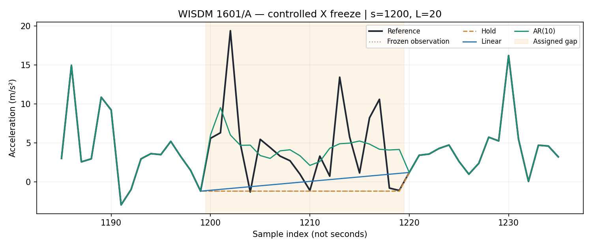
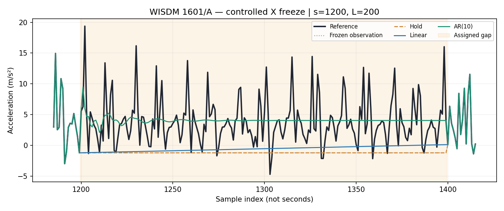
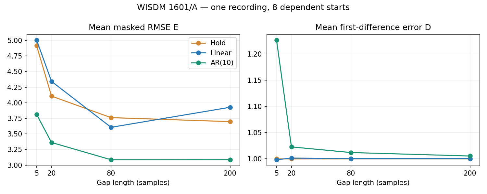
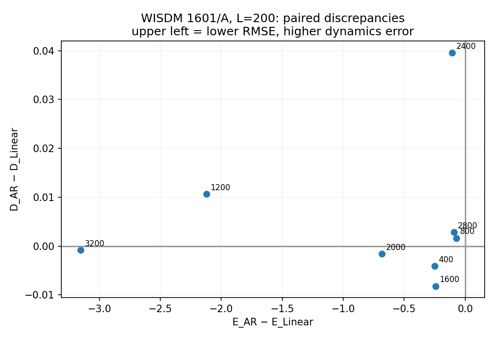

# LAB-043 · Как оценивать восстановление замершего акселерометра

Рабочая карта для автора и проверяющего. Основной вопрос — сохранится ли порядок методов, если после ошибки значений проверить ошибку приращений между соседними отсчётами? Единица сравнения — один искусственно повреждённый интервал одной записи ходьбы WISDM 1601/A. Решение 00 допускает фактические материалы только в этих пределах. [Задание и решение 00](https://github.com/kr13t1/ts-reliability-lab/issues/42) · [Аудит 05](https://github.com/kr13t1/ts-reliability-lab/pull/41#issuecomment-7014303678)

## Каркас самостоятельного текста

| Раздел | На какой вопрос автор отвечает своими словами | На что опираться |
|---|---|---|
| Наблюдение | Почему гладкий прогноз может оказаться близким к измерениям и всё же терять колебания? | Фиксированный длинный интервал ниже |
| Предыстория | Как возник вопрос о второй метрике? | Первый разведочный пилот 1600/A, 3574 отсчёта. Упомянуть отдельно, не объединять выборки. [Пилот](../../explorations/repair_pilot/README.md) |
| Постановка | Кто знает границы сбоя? Что из сигнала доступно каждому методу? | Маска и три способа заполнения в [методической карточке](METHOD.md) |
| Две шкалы ошибки | Что означает единица на шкале D? Почему точки на диаграмме парные? | Формулы E, D, V и контроль Hold |
| Разбор результата | Что видно в одном интервале, повторяется ли знак во всех восьми? | Два фиксированных интервала, средние по длинам, восемь пар |
| Предел вывода | Что пришлось бы проверять отдельно для реального устройства или распознавания активности? | [Границы и проверка источников](VERIFY.md) |

Автор самостоятельно пишет заголовок, основной текст и подписи для публикации. Эти карточки служат для проверки фактов. Правило 4 Хабра распространяется и на частичную генерацию или редактирование текста нейросетью. Публичная передача иллюстраций требует отдельного решения 00. [Правила Хабра](https://habr.com/ru/docs/help/rules/) · [Разъяснение редакции](https://habr.com/ru/companies/habr/articles/1019036/)

## Четыре изображения из принятого запуска

**1. Короткий интервал.** Затенение задаёт известные индексы замены, по горизонтали — номер отсчёта, по вертикали — ускорение X в м/с². Для s=1200, L=20 сравните наклон прямой между границами и первые шаги рекурсивного прогноза. В этом окне E у AR и Linear равна 4,782 и 7,019 м/с² соответственно. [Строки окна](evidence/results.csv)

**2. Длинный интервал с тем же началом.** Для s=1200, L=200 ошибка E составляет 3,756616 у AR против 5,877733 м/с² у Linear. По D порядок обратный — 1,010637 против 1,000003. У AR отношение дисперсий V=0,01826070888061779. Внутри маски прогноз сохраняет около 1,83% дисперсии исходных значений. Это описание затухания на данном окне. [Строки окна](evidence/results.csv)

**3. Средние восьми окон.** Каждая ячейка ниже содержит среднее E (м/с²) и среднее D (безразмерное), округлённые до шести знаков. Сначала вычисляется ошибка каждого окна, затем среднее по восьми стартам. [Полная точность и знаменатели](evidence/summary_methods.csv)

| L, отсчёты | Hold · E / D | Linear · E / D | AR(10) · E / D |
|---:|---:|---:|---:|
| 5 | 4,914632 / 1 | 5,004874 / 0,997837 | 3,813397 / 1,226635 |
| 20 | 4,106973 / 1 | 4,342744 / 1,001037 | 3,363079 / 1,022425 |
| 80 | 3,761524 / 1 | 3,606238 / 0,999984 | 3,086213 / 1,011640 |
| 200 | 3,697669 / 1 | 3,927826 / 1,000007 | 3,087551 / 1,005006 |

**4. Основное парное сравнение.** Одна точка соответствует одному старту при L=200. Вычитать Linear из AR(10) в том же окне. Все восемь точек имеют отрицательную ΔE. Положительная ΔD встречается у четырёх стартов (800, 1200, 2400, 2800), отрицательная — у остальных четырёх. Подписи 800 и 2800 близки, точные координаты доступны в CSV. [Пары](evidence/paired.csv) · [Итог по парам](evidence/summary_paired.csv)

Средняя ΔE = −0,8402744314031096 м/с², средняя ΔD = +0,00499942910532615, медиана ΔD = +0,00040576326588670497. Зафиксированное расхождение двух критериев встретилось в 4/8 окон. Малый положительный сдвиг средней D при поровну разделившихся знаках ограничивает интерпретацию. Статус протокола — TARGET_DISCORDANCE_OBSERVED / COMPLETE_PLAN.
